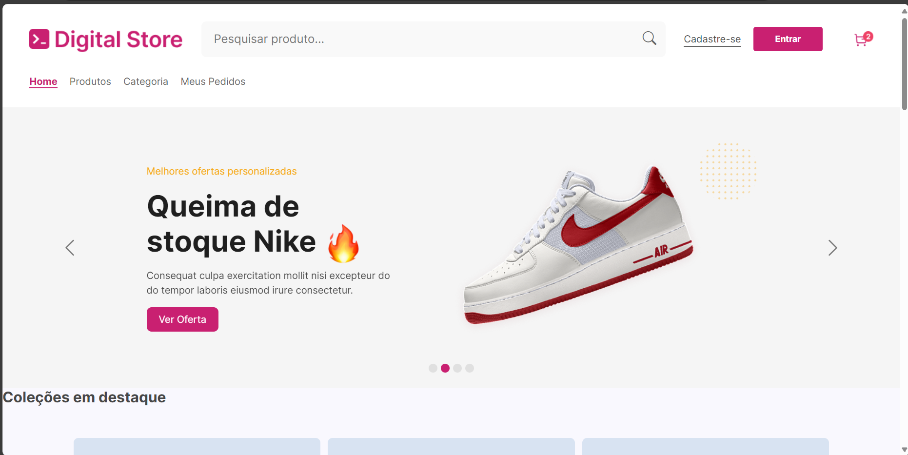
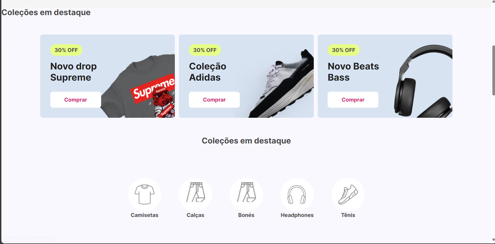
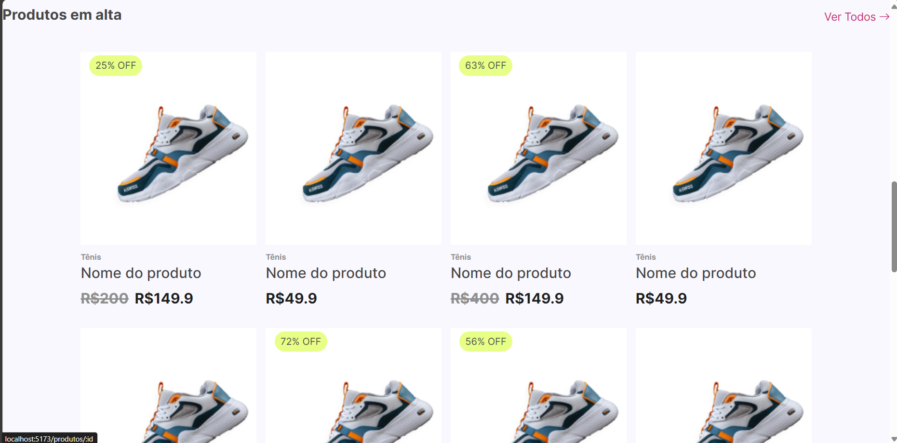
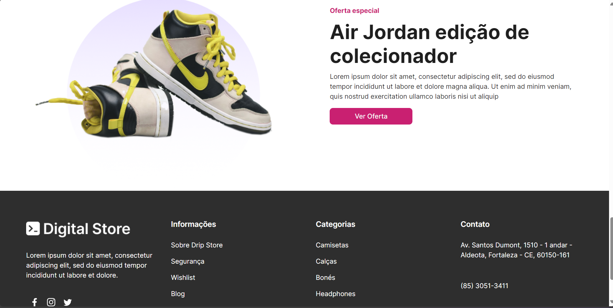
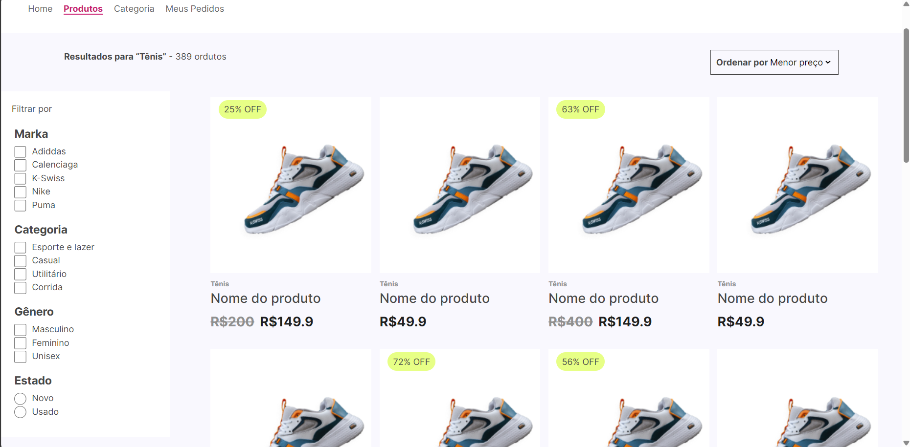
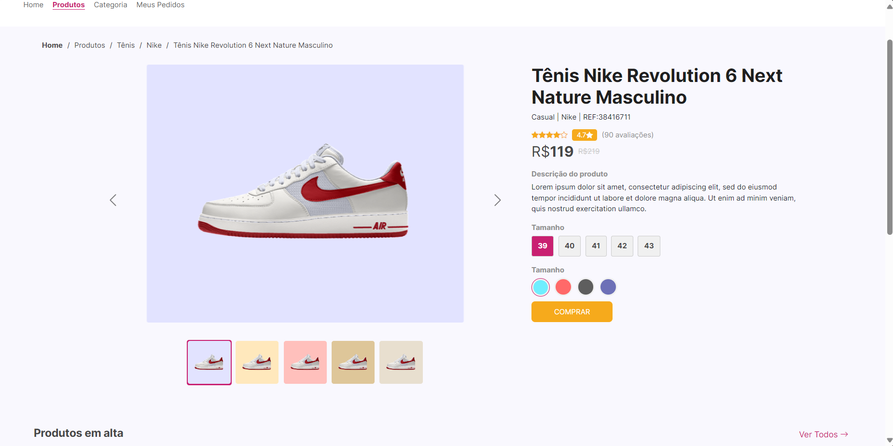
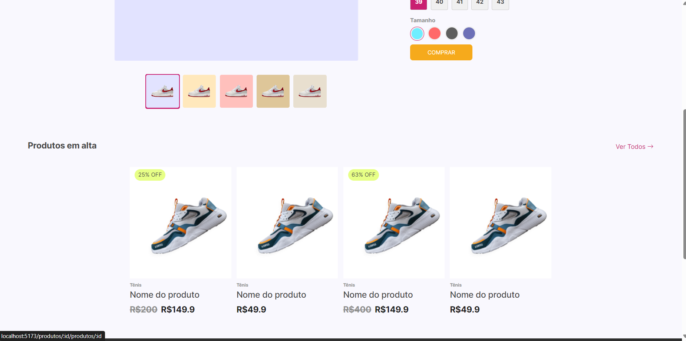

# Digital Store

Loja virtual demonstrativa criada com React e Vite. O projeto apresenta uma vitrine de produtos com busca, filtros, ordenação e páginas de detalhes usando um catálogo local de demonstração.

> Este projeto foi desenvolvido durante minha formação no Geração Tech / Digital College e posteriormente revisado para aplicar melhorias de organização, responsividade, qualidade de código e boas práticas adquiridas com experiência profissional.

## Contexto e tecnologias

O Digital Store é um projeto acadêmico de frontend. A revisão mantém o React, a estrutura de SPA e a identidade original; não adiciona backend nem transforma o exercício em um produto comercial. O catálogo e os preços são dados locais de demonstração.

- React 18
- Vite 6
- React Router 7
- Bootstrap 5 e Bootstrap Icons
- React Icons
- PropTypes
- ESLint

## Funcionalidades e páginas

- **Início (`/`)**: banners, coleções, categorias, produtos em destaque e oferta especial.
- **Produtos (`/produtos`)**: listagem, pesquisa textual, filtros por categoria e faixa promocional, e ordenação por preço.
- **Detalhe (`/produtos/:id`)**: exibe o produto selecionado, galeria, valores, opções demonstrativas de tamanho/cor e produtos em destaque. IDs inválidos mostram a página 404.
- **Categoria, pedidos, cadastro, login e carrinho**: telas de apresentação “em construção”, preservadas do projeto acadêmico.
- **Rotas desconhecidas**: página 404 com retorno para o início.

O botão de compra permanece desativado porque não há carrinho ou fluxo de compra implementado. As imagens e os nomes genéricos também fazem parte do catálogo de demonstração original.

## Estrutura principal

O aplicativo Vite fica na subpasta `Digital-Store/`; screenshots originais estão em `imagensProjeto/` na raiz.

```text
Digital-Store/
├── src/
│   ├── components/       # Header, Footer, galeria, filtros e cards
│   ├── Context/          # Contexto e provider dos dados da loja
│   ├── data/             # Catálogo local de produtos
│   ├── Pages/            # Início, listagem, detalhes e páginas estáticas
│   ├── routes/           # Rotas da aplicação
│   ├── App.jsx
│   └── main.jsx
├── index.html
├── package.json
└── vite.config.js
imagensProjeto/           # Capturas de tela originais
```

## Executar localmente

Requer Node.js 20 ou superior e npm. Rode os comandos dentro da pasta da aplicação:

```sh
cd Digital-Store
npm ci
npm run dev
```

O Vite informa o endereço local no terminal. Para validar o código e criar uma build de produção:

```sh
npm run check
npm run build
npm run preview
```

`npm run check` executa ESLint e build. O projeto não possui suíte de testes automatizados neste momento.

## Capturas originais

As imagens abaixo já estavam no repositório e foram mantidas:

### Início






### Produtos e detalhes





## Créditos

Projeto original desenvolvido por:

- Luis César
- Natanael Neves
- Lucas Duarte

## Links

- [Portfólio](https://luiscesardev.com.br)
- [LinkedIn](https://www.linkedin.com/in/luis-cesar/)
- [GitHub](https://github.com/Luis-Cesar0)

## Melhorias futuras

- Substituir os dados genéricos por um catálogo de demonstração mais completo e consistente.
- Implementar carrinho e fluxo de compra caso o escopo acadêmico seja expandido.
- Implementar conteúdo próprio nas páginas informativas que hoje reutilizam a tela genérica “em construção”.
- Adicionar testes de integração e de navegação para busca, filtros e detalhes.
- Configurar fallback de SPA ao publicar em hospedagem estática para suportar acesso direto a rotas internas.
